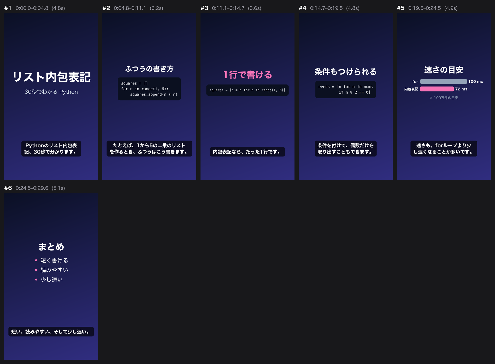

# Paibot Video

[English](README.md) | **日本語**

動画を JSON で書くと、読み上げ・字幕・動く文字・コード・カウンター・グラフの入った MP4 になります。**AI エージェントが JSON を書き、自分で確かめ、自分で直せる**ように作っています。人が下書きを毎回見なくても進められます。

<p align="center"></p>

```sh
pip install paibot-video        # FFmpeg が必要です
paibot-video init video.json    # 見本の台本を作る
paibot-video check video.json --sheet sheet.png
paibot-video render video.json -o video.mp4
```

```json
{
  "preset": "shorts",
  "captions": true,
  "background": {"gradient": ["#0b1024", "#312e81"], "angle": 160},
  "scenes": [
    {
      "narration": "内包表記なら、たった1行です。",
      "elements": [
        {"type": "text", "text": "1行で書ける", "size": 100},
        {"type": "code", "code": "squares = [n * n for n in range(1, 6)]", "animate": "type"}
      ]
    }
  ]
}
```

座標も秒数も書かなくて構いません。要素はセーフエリア（スマホのアプリのボタンなどに隠れない範囲）の中で自動で縦に並び、シーンの長さは読み上げの長さで決まります。

## AI エージェント向けの作り

たいていの動画ツールは、人がプレビューを見る前提で作られています。Paibot Video は、エージェントが一人で作業を進めるのに要るものをそろえています。

- **`paibot-video guide`**：言語モデル向けの短い書き方ガイドを出します。エージェントのプロンプトにそのまま入れられます。
- **`paibot-video schema`**：JSON Schema を出します。構造化出力を使うツール向けです。
- **`paibot-video check --json`**：問題を一つ残らず、JSON 上の場所と具体的な直し方付きで返します。「不正です」だけでは終わりません。

  ```text
  ERROR   $.scenes[0].elements[0].txt: unknown field
          ↳ did you mean `text`?
  ERROR   $.scenes[1].duration: the voice is 5.3s and starts at 0.3s, so it would be cut off at 4s
          ↳ use "duration": "auto" or at least 6.2
  WARNING $.scenes[3].elements[1].code: the longest line (39 characters) does not fit, so the code was shrunk from 44px to 37px
          ↳ code is never wrapped: split lines to about 31 characters, or use a landscape preset
  ```

  見る人が気づくことを調べます。たとえば、文字が画面の外やスマホのアプリが重なる場所に出る、要素が縦に入りきらない、文字同士が重なる、背景とのコントラストが低い、スマホでは小さすぎる、読み切れないうちに消える、読み上げが途中で切れる、などです。
- **`--sheet sheet.png`**（または `paibot-video sheet`）：全シーンを 1 枚の画像にまとめます。画像を見られるモデルなら、一目で動画全体を確かめられます。

  

- **`paibot-video frame --scene 3`**：1 シーンを PNG で出します。
- 結果はいつも同じです。同じ JSON からは必ず同じ動画ができます。

エージェントの作業は「JSON を書く → `check --json --sheet` → 直す → 繰り返す → `render`」の流れになります。[examples/comprehension.json](examples/comprehension.json) はこの流れで作りました。

## 要素

| type | 中身 |
| --- | --- |
| `text` | 見出しやラベル。日本語も英語も正しく折り返します（行頭禁則あり）。後ろに箱も付けられます。 |
| `bullets` | 1 項目ずつ現れる箇条書き。 |
| `image` | PNG・JPEG。`fit`、角丸、ゆっくり寄る `zoom` が使えます。 |
| `shape` | 四角と円。 |
| `code` | 1 文字ずつ打ち込む演出ができるコード。折り返さず、幅が足りないと縮めて `check` で知らせます。 |
| `counter` | カウントアップする数字。前後に文字を付けられます。 |
| `bars` | 伸びながら現れる横棒グラフ。 |

どの要素にも `start`、`end`、`animate`（`fade`、`pop`、`slide-up/down/left/right`、`zoom`、`type`、`none`）、`out: "fade"`、`opacity` があります。シーンの入り方は `fade`、`slide`、`wipe`、`zoom`、`none` から選べます。背景は単色・グラデーション・写真（`dim` で暗くできる）が使えます。

すべての項目は `paibot-video guide` で見られます。

## 音

- **`narration`**：読み上げる文章です。macOS では `say` を使い、日本語の文章には日本語の声を自動で選びます。Linux では `espeak-ng` を使います。`PAIBOT_VIDEO_TTS="mytts --text-file {text_file} --out {out}"` のように書けば、どの読み上げエンジンでもつなげられます。作った音声は `.paibot-video-cache/` に取っておき、使い回します。
- **`audio`**：録音済みのファイルをシーンで流します。
- **`captions: true`**：読み上げを字幕にします。文ごとに区切り、声に合わせて切り替えます。
- **`music`**：BGM です。繰り返し流し、声の下に混ぜ、最後はフェードアウトします。

## コマンド

| コマンド | |
| --- | --- |
| `render SPEC [-o out.mp4] [--preview] [--scale 0.5] [--fps N] [--force] [--json]` | MP4 を書き出します。`check` でエラーがあると書き出しません（`--force` で強制）。`--preview` は半分の大きさ・15fps です。 |
| `check SPEC [--json] [--sheet PNG] [--no-tts]` | 検査します。エラーがあれば終了コード 1 です。 |
| `frame SPEC (--scene N \| --at 秒) [-o PNG]` | 1 コマを出します。 |
| `sheet SPEC [-o PNG] [--cols N]` | 全シーンを 1 枚にまとめます。 |
| `schema` / `guide` / `init [PATH]` | JSON Schema、書き方ガイド、見本の台本を出します。 |

大きさは `shorts` 1080×1920（既定）、`landscape` 1920×1080、`square` 1080×1080、`portrait` 1080×1350 から選ぶか、`width`/`height` で好きに決められます。

## 必要なもの

- Python 3.10 以降と Pillow（自動で入ります）。
- FFmpeg（`ffmpeg` と `ffprobe`）。書き出しと音声に使います。
- 使う言語の文字が入ったフォント。macOS・Windows・主な Linux（Noto Sans CJK）では日本語フォントを自動で見つけます。見つからないときは、台本の `font` か、`PAIBOT_VIDEO_FONT` / `PAIBOT_VIDEO_FONT_BOLD` で指定してください。

## 開発

```sh
uv sync
uv run pytest
cd examples && uv run paibot-video render comprehension.json
```

## ライセンス

MIT
