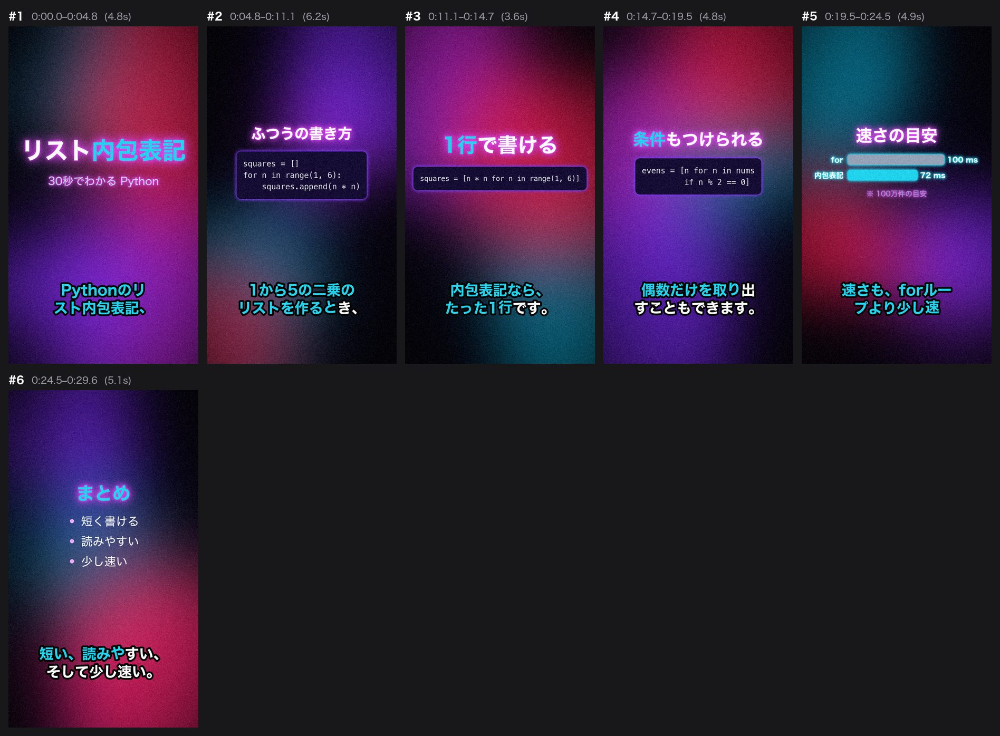

# Paibot Video

**English** | [日本語](README.ja.md)

Write a video as JSON and get an MP4 with narration, captions, animated text, code, counters and charts. It is built so that **an AI agent can write the JSON, check its own work and fix it** without a person watching every draft.

<p align="center"></p>

```sh
pip install paibot-video        # needs FFmpeg on PATH
paibot-video init video.json    # an example to start from
paibot-video check video.json --sheet sheet.png
paibot-video render video.json -o video.mp4
```

```json
{
  "preset": "shorts",
  "captions": true,
  "background": {"gradient": ["#0b1024", "#312e81"], "angle": 160},
  "scenes": [
    {
      "narration": "内包表記なら、たった1行です。",
      "elements": [
        {"type": "text", "text": "1行で書ける", "size": 100},
        {"type": "code", "code": "squares = [n * n for n in range(1, 6)]", "animate": "type"}
      ]
    }
  ]
}
```

No coordinates and no timings are needed. Elements stack themselves inside the safe area, and each scene lasts as long as its narration.

Add `"theme": "neon"` (or `pop`, `cinematic`) for a finished look in one line: drifting light, glowing text that bounces in word by word, glitch cuts, karaoke captions, film grain and sound effects. Mark words with `**…**` to colour them.

## Made for AI agents

Most video tools assume a person is watching the preview. Paibot Video gives an agent what it needs to work alone:

- **`paibot-video guide`** prints a short authoring guide written for a language model. Put it in the agent's prompt.
- **`paibot-video schema`** prints the JSON Schema, for tools that use structured output.
- **`paibot-video check --json`** reports every problem with a JSON path and a concrete fix, not just "invalid":

  ```text
  ERROR   $.scenes[0].elements[0].txt: unknown field
          ↳ did you mean `text`?
  ERROR   $.scenes[1].duration: the voice is 5.3s and starts at 0.3s, so it would be cut off at 4s
          ↳ use "duration": "auto" or at least 6.2
  WARNING $.scenes[3].elements[1].code: the longest line (39 characters) does not fit, so the code was shrunk from 44px to 37px
          ↳ code is never wrapped: split lines to about 31 characters, or use a landscape preset
  ```

  It checks what a viewer would notice: text going off screen or into the area that phone apps cover, stacks that don't fit, overlapping text, low contrast, text too small for a phone, text shown too briefly to read, and narration that would be cut off.
- **`--sheet sheet.png`** (or `paibot-video sheet`) saves every scene in one image, so a model that can see images checks the whole video with one look:

  

- **`paibot-video frame --scene 3`** renders a single scene as PNG.
- Everything is deterministic: the same JSON always gives the same video.

A typical agent loop is *write JSON → `check --json --sheet` → fix → repeat → `render`*. The examples in [examples/](examples/) were made that way.

## Elements

| type | what it is |
| --- | --- |
| `text` | Headlines and labels. Japanese and English wrap correctly (line-break rules included). Optional box behind it. |
| `bullets` | A list whose items appear one by one. |
| `image` | PNG/JPEG, with `fit`, rounded corners and a slow `zoom`. |
| `shape` | Rectangles and circles. |
| `code` | A code block that can be typed out. Lines are never wrapped; a wide block is shrunk and `check` tells you. |
| `counter` | A number counting up, with prefix and suffix. |
| `bars` | A horizontal bar chart whose bars grow in. |

Every element has `start`, `end`, `animate` (`fade`, `pop`, `words`, `wipe`, `blur`, `slide-up/down/left/right`, `zoom`, `type`, `none`), `out: "fade"`, `opacity`, `glow` and `shadow`; text can have an outline (`stroke`). Scenes enter with `fade`, `slide`, `wipe`, `zoom`, `flash`, `glitch` or `none`, and the `camera` can push in, pull out or drift. Backgrounds can be a colour, a gradient, a photo (with `dim`) or moving colour orbs. `grain` and `vignette` give a film look.

## Themes

| theme | look |
| --- | --- |
| `clean` | Default. Plain and quiet. |
| `neon` | Drifting colour orbs, glowing text, word-by-word entrances, glitch cuts, karaoke captions, grain, sound effects. |
| `pop` | Bright orbs, outlined text with shadows, slide cuts, karaoke captions, sound effects. |
| `cinematic` | Dark and grainy with a vignette, text emerging from a blur, slow camera push. |

A theme only fills in defaults; anything you write yourself wins.

Run `paibot-video guide` for the full list of fields.

## Sound

- **`narration`**: text that is spoken. Paibot Video uses the first engine that is running:
  1. [AivisSpeech](https://aivis-project.com/) — natural Japanese, free, runs locally (port 10101).
  2. [VOICEVOX](https://voicevox.hiroshiba.jp/) — free, many character voices (port 50021).
  3. The system voice: `say` on macOS, `espeak-ng` on Linux.

  Pick a voice with `"voice": "まお"` or `"まお/おちつき"` (a wrong name gets you the list of voices), tune it with `speed` and `intonation`, or force an engine with `"tts"`. Any other engine plugs in with `PAIBOT_VIDEO_TTS="mytts --text-file {text_file} --out {out}"`. Results are cached in `.paibot-video-cache/`. Check each voice's license for credit rules (VOICEVOX voices need a credit such as "VOICEVOX:ずんだもん").
- **`audio`**: a recorded file for the scene instead.
- **`captions: true`** shows the narration as subtitles, split by sentence and timed to the voice. `captionStyle: "karaoke"` shows big outlined words that light up as they are spoken.
- **`sfx: true`** adds a whoosh on transitions and a pop when things land.
- **`music`**: background music, looped, mixed under the voice and faded out at the end.

## Commands

| command | |
| --- | --- |
| `render SPEC [-o out.mp4] [--preview] [--scale 0.5] [--fps N] [--force] [--json]` | Write the MP4. Refuses if `check` finds errors unless `--force`. `--preview` is half size at 15 fps. |
| `check SPEC [--json] [--sheet PNG] [--no-tts]` | Validate and lint. Exit code 1 if there are errors. |
| `frame SPEC (--scene N \| --at SEC) [-o PNG]` | One frame. |
| `sheet SPEC [-o PNG] [--cols N]` | All scenes in one image. |
| `schema` / `guide` / `init [PATH]` | JSON Schema, the authoring guide, an example spec. |

Presets: `shorts` 1080×1920 (default), `landscape` 1920×1080, `square` 1080×1080, `portrait` 1080×1350, or any `width`/`height`.

## Requirements

- Python 3.10+ and Pillow (installed automatically).
- FFmpeg (`ffmpeg` and `ffprobe` on PATH) for rendering and audio.
- A font that covers your language. A system Japanese font is found automatically on macOS, Windows and most Linux distributions (Noto Sans CJK). Otherwise set `font` in the spec or `PAIBOT_VIDEO_FONT` / `PAIBOT_VIDEO_FONT_BOLD`.

## Development

```sh
uv sync
uv run pytest
cd examples && uv run paibot-video render comprehension.json
```

## License

MIT
